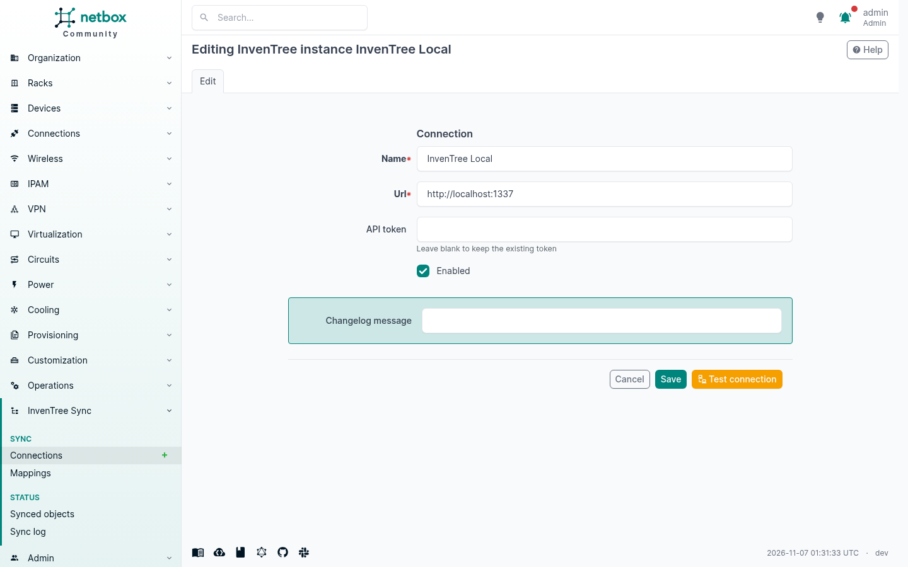
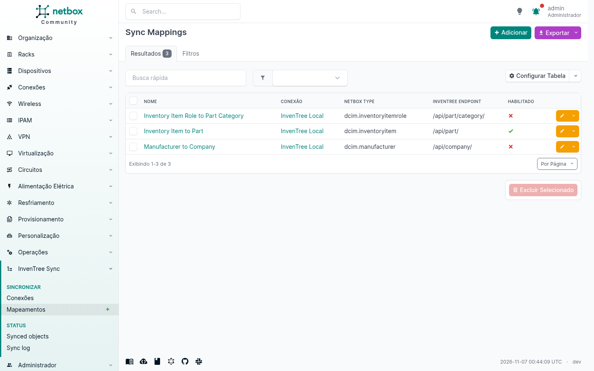
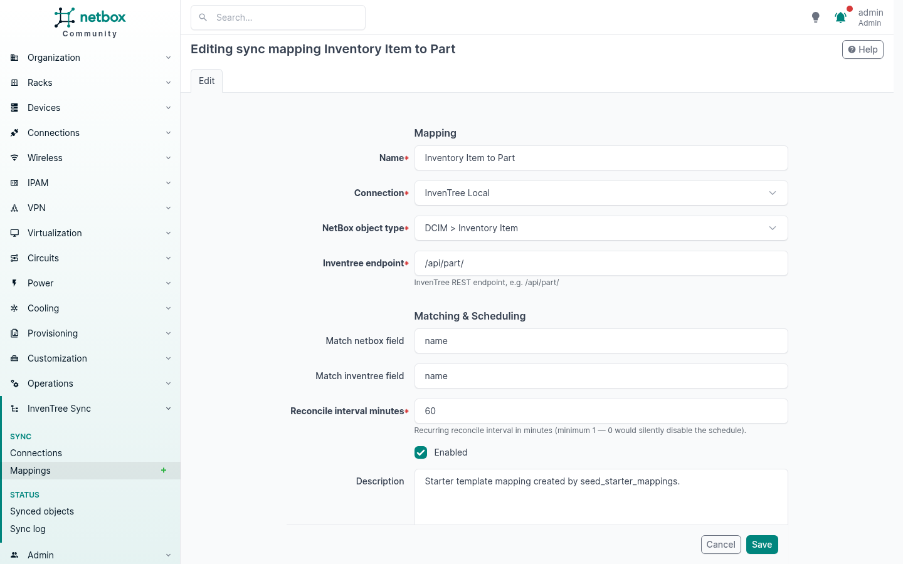
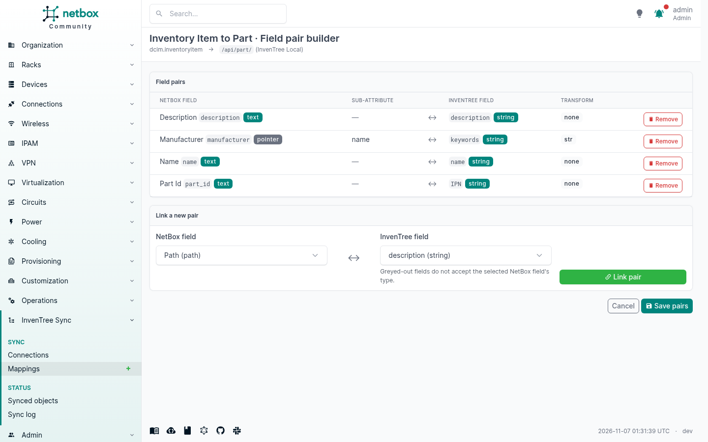
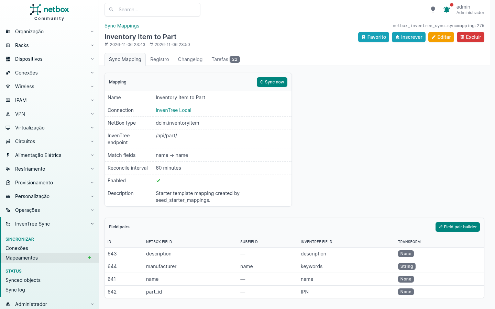
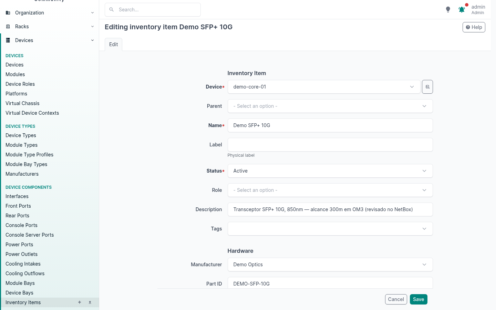
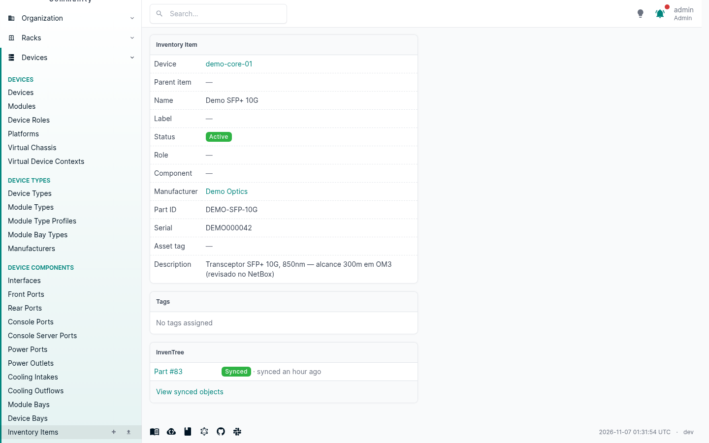
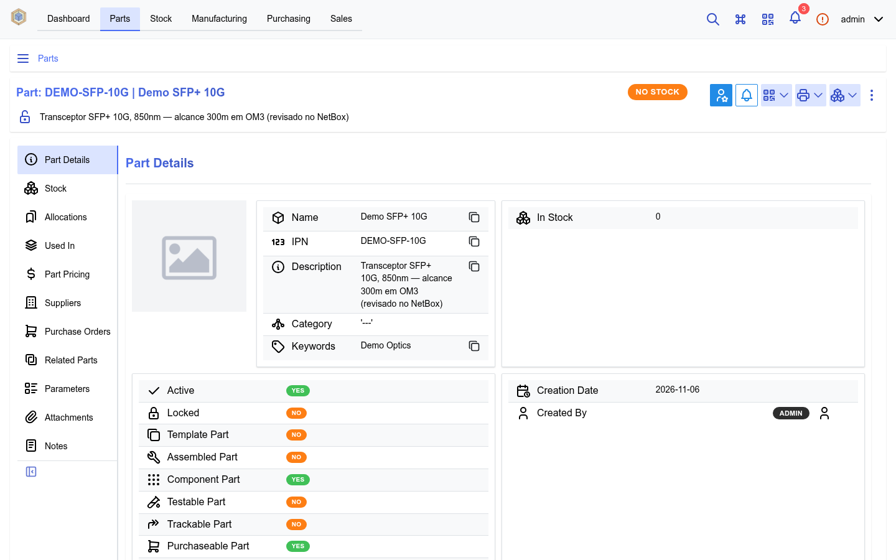
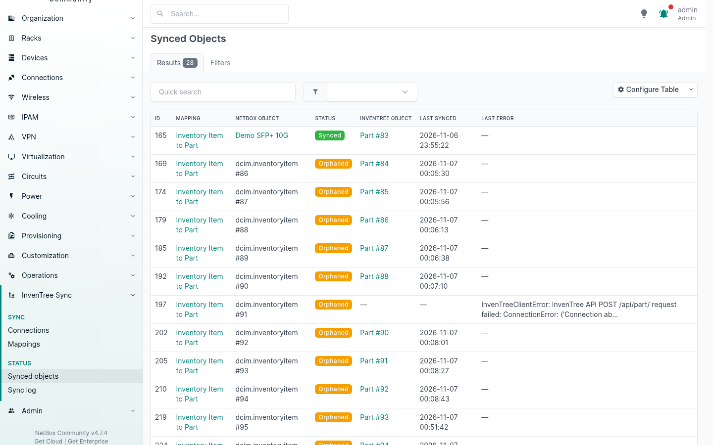

# netbox-inventree-sync

A NetBox plugin that synchronizes NetBox inventory data to
[InvenTree](https://inventree.org).

NetBox is the source of truth: mapped objects are pushed to InvenTree on
every change (create/update via a background job, delete via remote
deactivation — InvenTree objects are never deleted), and a recurring
reconcile pass re-verifies every link against the live InvenTree state and
repairs drift. Mappings pair NetBox fields with InvenTree endpoint fields
through a type-compatibility matrix, with pointer→related pairs resolving
depth-first through pairing mappings (e.g. Inventory Item Role → Part
Category before the part that references it).

## Development environment

One-time setup:

```bash
./scripts/setup_netbox.sh     # clone NetBox v4.7.4, build netbox/venv, migrate, seed admin+token, install this plugin
./scripts/setup_inventree.sh  # InvenTree 1.7 stack (docker compose), seed admin+token
```

Daily start (idempotent — re-running restarts the detached processes and
picks up code changes):

```bash
./scripts/start.sh            # docker compose up -d + NetBox runserver + rqworker (supervised, logs under /tmp/opencode/netbox-inventree-sync/)
```

After that:

- NetBox at <http://localhost:8000> (admin / admin); its API token is
  written to `.env` as `NETBOX_TOKEN`.
- InvenTree at <http://localhost:1337>; its API token is written to `.env`
  as `INVENTREE_TOKEN`.
- The RQ worker must be running for signal-driven syncs and reconciles
  (`start.sh` starts it; check `/api/core/background-workers/`).

Requires: Python 3.12+ (a uv-managed install works — see
`scripts/setup_netbox.sh`), Docker with compose v2.

## Installing into a running production environment

The development setup above builds a throwaway stack. This section is for
adding the plugin to NetBox and InvenTree installations that already run
with real data.

**What the plugin touches — and what it never touches:**

- In NetBox, the plugin creates **only its own tables**
  (`netbox_inventree_sync_*`: connections, mappings, field pairs, the
  link table, the sync log). It never modifies, migrates or deletes any
  existing NetBox table, and it never writes to NetBox objects — the
  engine only *reads* mapped objects.
- InvenTree is contacted **exclusively through its REST API** with a
  token you configure. The plugin never connects to InvenTree's database.
- The InvenTree side is never deleted from: removing a NetBox object
  *deactivates* its remote counterpart. Existing InvenTree parts are
  adopted through match keys only when the match is unambiguous
  (`name`→`name` by default); anything ambiguous or blank is flagged for
  manual review and left untouched.

Consequently, installing — or removing — the plugin cannot lose data in
either system. Still, take a standard backup before any production
change (`pg_dump` of the NetBox database at minimum).

Steps:

1. **Backup** — `pg_dump` the NetBox database (and InvenTree's, if you
   want the extra comfort).
2. **Create an InvenTree API token** for a dedicated service user with
   write access limited to what you plan to sync (parts, companies,
   categories). The token is stored in NetBox's database (plaintext at
   rest, write-only over the API — treat your DB backups accordingly).
3. **Install the package into NetBox's Python environment** (the same
   virtualenv/containers that run NetBox):

   ```bash
   pip install netbox-inventree-sync
   ```

   To track the project's development instead of a PyPI release, install
   from the repository directly:
   `pip install git+https://github.com/edurbs/netbox-inventree-sync.git`.

   For containerized NetBox (e.g. netbox-docker), install the package
   inside the image build (a custom `Dockerfile` extending the official
   image with the `pip install` above) so it survives recreation.
4. **Enable the plugin** in `configuration.py` (no plugin settings are
   required):

   ```python
   PLUGINS = ['netbox_inventree_sync']
   ```

5. **Migrate and collect static files** — this only creates the plugin's
   own tables:

   ```bash
   python manage.py migrate
   python manage.py collectstatic --no-input
   ```

6. **Restart every NetBox process — including the RQ worker(s)**. The
   web processes serve the plugin's UI; the workers execute the sync
   jobs. A worker that was not restarted will not know the plugin
   exists.
7. **Roll out gradually**: create the connection, run
   `seed_starter_mappings --connection <name> --validate` (everything is
   created *disabled*), review the pairs in the builder, then enable one
   mapping and watch *Synced Objects* / *Sync Log*. Be aware of the
   first-reconcile note below: enabling a mapping publishes every
   mapped-but-unlinked NetBox object, so on a large catalog the first
   pass is long.

**Rollback / removal:** disable all mappings (this cancels their
recurring schedules and stops event-driven pushes), remove the plugin
from `PLUGINS`, restart the processes. Optionally drop the plugin's
tables or simply delete its rows — no NetBox inventory data is involved.
InvenTree keeps whatever was synced (deactivated items stay
deactivated); simply delete or reactivate them there if you retire the
integration.

## Usage walkthrough

1. **Create a connection** — *Plugins → InvenTree Sync → InvenTree
   Instances → Add*: base URL (e.g. `http://localhost:1337`) and an API
   token of a InvenTree user with write access. The token is stored
   server-side and never returned by the API. The edit form offers a
   *Test connection* probe (the token field stays blank on edit —
   leaving it blank keeps the stored token):

   

2. **Seed the starter mappings** (or add mappings by hand):

   ```bash
   netbox/venv/bin/python netbox/netbox/manage.py seed_starter_mappings --connection <id-or-name> --validate
   ```

   This creates three *disabled* mappings: Inventory Item → `/api/part/`
   (name→name, part_id→IPN, description→description,
   `manufacturer.name`→keywords), Manufacturer → `/api/company/`, and
   Inventory Item Role → `/api/part/category/`, each with name→name as
   its match (adopt) key. `--validate` checks every pair against the
   live InvenTree field metadata. After seeding, the Mappings list shows
   all three (✔/✗ in the *Enabled* column):

   

3. **Enable a mapping** — edit it in the UI (or `PATCH .../mappings/<id>/`
   `{"enabled": true}`). Enabling schedules a recurring reconcile job at
   the mapping's `reconcile_interval_minutes` (default 60); the interval
   schedule is replaced whenever the mapping is saved with a new interval
   and removed when the mapping is disabled:

   

4. **Open the mapping builder** — the *Field pairs* tab of a mapping
   renders both field lists (NetBox content-type fields incl. custom
   fields and tags; the InvenTree endpoint's writable fields) with
   incompatible pairings greyed out. Saving validates server-side
   through the same compatibility gate as the REST API:

   

5. **Sync now** — the *Sync now* button on a mapping (or
   `POST /api/plugins/netbox_inventree_sync/mappings/<id>/sync/`)
   enqueues a one-shot reconcile in addition to the recurring schedule.
   This works on *disabled* mappings too (deliberate): the action runs
   regardless of the `enabled` flag, so a mapping can be exercised once
   before its schedule and event-driven pushes are turned on:

   

From then on, saving a mapped NetBox object enqueues a push, and deleting
one deactivates (never deletes) the remote counterpart. Status per object:
*Plugins → InvenTree Sync → Synced Objects*; every push attempt is logged
in *Sync Log*.

## Seeing it in action

The screenshots below show how the application works, taken from the
live dev stack. First, the mapping's **field-pair builder**: NetBox
fields on the left, the InvenTree endpoint's fields on the right, linked
pairs with type badges — and options whose types don't accept the
selected NetBox field are greyed out (the helper line under the selects
says so; the server enforces it on save). This example is the starter
Inventory Item → Part mapping (name→name, part_id→IPN,
description→description, and the manufacturer pointer rendered as text
into keywords):


Next, one complete round trip of a sync under the Inventory Item → Part
mapping (starter field pairs: name→name, part_id→IPN,
description→description, `manufacturer.name`→keywords).

**1. The modification is made in the NetBox UI** — editing the
`Demo SFP+ 10G` inventory item and changing its *Description* to
"Transceptor SFP+ 10G, 850nm — alcance 300m em OM3 (revisado no NetBox)":



**2. Saving enqueues the push** — the object's detail page now shows the
*InvenTree* panel (added by the plugin) with the link's status: the part
was pushed and is *Synced*, with the InvenTree object (`Part #83`) one
click away:



**3. The change is reflected in the InvenTree UI** — opening that part in
InvenTree shows the description exactly as saved in NetBox (and the other
mapped fields: IPN, name, and keywords carrying the manufacturer name).
No one touched InvenTree — the background job pushed the edit within
seconds of the save:



The same happens on create (a new mapped object publishes a new InvenTree
part) and on delete (the InvenTree object is deactivated, never deleted);
manual edits made directly in InvenTree are overwritten by the next push
or reconcile, since NetBox is the source of truth.

Every link is visible under *Plugins → InvenTree Sync → Synced Objects*,
with per-object status, the InvenTree counterpart one click away, and the
last error (if any) — here showing green *Synced* rows alongside orange
*Orphaned* ones (links whose NetBox object was deleted):




> **Sync log retention**: `SyncLogEntry` grows unboundedly — one row per
> push attempt, reconcile included. There is no automatic retention in
> v1; prune old rows manually if the table grows too large
> (e.g. `SyncLogEntry.objects.filter(created__lt=...)` in a shell).

### Deterministic sync from the CLI

The `inventree_sync` management command runs the production job classes
inline (no worker round-trip) — the E2E determinism tool:

```bash
netbox/venv/bin/python netbox/netbox/manage.py inventree_sync --mapping '<name>'                     # every pending/failed link
netbox/venv/bin/python netbox/netbox/manage.py inventree_sync --mapping '<name>' --object dcim.inventoryitem:42
netbox/venv/bin/python netbox/netbox/manage.py inventree_sync --mapping '<name>' --reconcile
```

Exit code 1 when any processed object ended `failed`.

### Reconcile intervals

Each enabled mapping carries `reconcile_interval_minutes` (default 60).
The recurring `ReconcileJob` authoritatively re-verifies every synced
link (drift in InvenTree is overwritten, vanished remotes re-created),
retries failed links, publishes unlinked NetBox objects through the
mapping's match/adopt policy, and orphans links whose NetBox object is
gone. Keep the interval short for busy catalogs (each pass GETs every
linked remote object).

Note on scale: the **first** reconcile after a mapping starts working
publishes every mapped NetBox object that has no link yet — on a large
catalog that is one InvenTree create per object, so expect a long first
pass (and a correspondingly large first-pass sync log).

## Running plugin tests

Unit suite (Django test runner, own database; hermetic — InvenTree is
stubbed):

```bash
NETBOX_CONFIGURATION=netbox.configuration_test \
    netbox/venv/bin/python netbox/netbox/manage.py test netbox_inventree_sync -v 1 --keepdb --noinput
```

`setup_netbox.sh` provisions `netbox/netbox/netbox/configuration_test.py`
for this: it mirrors the dev config but disables `DEBUG`, so the Django
debug toolbar is not installed (with `DEBUG = True` every `manage.py test`
run fails at the `debug_toolbar.E001` system check before any test
executes).

E2E suite (pytest, `tests/e2e/`) against the **live** pair — prerequisites:
the full stack from `./scripts/start.sh` (runserver *and* rqworker) plus
the InvenTree containers, and `NETBOX_TOKEN` / `INVENTREE_TOKEN` in `.env`
(both written by the setup scripts):

```bash
cd netbox && ./venv/bin/python -m pytest ../tests/e2e -v
```

URLs/tokens can be overridden with `NETBOX_URL`, `NETBOX_TOKEN`,
`INVENTREE_URL`, `INVENTREE_TOKEN` environment variables. Every test
cleans up what it created in both systems (engine-created InvenTree
objects included) and isolates itself with unique `e2e-<run>` name
prefixes, so the suite can be re-run back-to-back. One scenario stops and
restarts the `inventree-web` compose service (~90 s); the async-path
scenario needs the RQ worker. Expect a full run to take 3–4 minutes
(each deterministic sync boots Django once).

## Troubleshooting

- **Ports**: NetBox dev server on :8000, InvenTree on :1337, NetBox
  Postgres on :15432 and Redis on :16379 (InvenTree's own Postgres/Redis
  are not published). `docker compose ps` shows the backing services.
- **Tokens**: both API tokens live in `.env` (written by the setup
  scripts). The plugin connection stores its own copy of the InvenTree
  token; if you regenerate the InvenTree token, update the connection.
- **"Jobs cannot be assigned to this object type (… Sync Mapping)"** when
  enabling a mapping right after a code update: NetBox caches each
  model's supported features in the `core_objecttype` table, refreshed
  only by the `post_migrate` signal. Run
  `netbox/venv/bin/python netbox/netbox/manage.py migrate` once (a no-op
  migrate is enough) to refresh it.
- **Worker**: signal-driven syncs and reconciles need the rqworker
  (`./scripts/start.sh`; verify via `/api/core/background-workers/`).
  Without it, changes only sync on the next `inventree_sync` run or
  reconcile.
- **A mapping's field pairs don't validate**: `POST /mappings/` and the
  builder validate against the endpoint's live OPTIONS metadata; an
  unreachable InvenTree fails the request (502 from the builder view)
  rather than accepting an unvalidated mapping.

## Support

Issues: https://github.com/edurbs/netbox-inventree-sync/issues

Before opening an issue, check
[COMPATIBILITY.md](https://github.com/edurbs/netbox-inventree-sync/blob/main/COMPATIBILITY.md)
for the supported NetBox / InvenTree / Python version matrix.

## License

Released under the MIT license — see
[LICENSE](https://github.com/edurbs/netbox-inventree-sync/blob/main/LICENSE).
